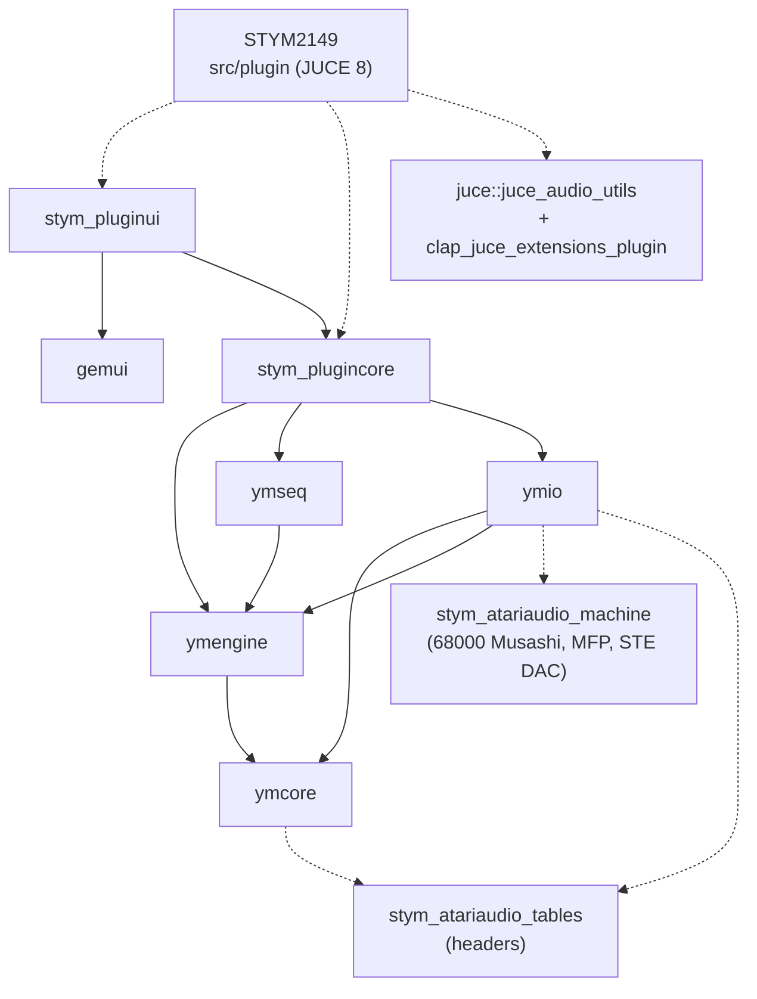

# STYM2149 architecture

Programming: Pascal "Indus" Nowak (with Claude's help) — Copyright © 2026 Indus / PRISM. Licence: AGPLv3.

This guide is for developers who take over or contribute to STYM2149. It describes the code as it is in the
repository; every statement points to the file that backs it. Items still open are marked **TO CONFIRM**.

Conventions you will meet everywhere:

- Source comments are in French. Decisions are numbered `D-nnn` in `DECISIONS.md`; milestone reports live in
  `docs/m0` to `docs/m8`; thresholds `S1` to `S11` come from `docs/m0/AUDIT_DSP.md` §5.
- Comments often cite `STYM2149_SPEC.md` (the specification) and `YM2149_Prototype.html` (the JavaScript
  prototype the product reproduces). Neither file is versioned in this repository; tools that need the prototype
  take its path as an argument (`tools/proto_golden/load.mjs`).
- Namespaces: `stym::ymcore`, `stym::ymengine`, `stym::ymseq`, `stym::ymio`, `stym::plugin` (plugincore and the
  JUCE glue), `stym::gemui`, `stym::pluginui`.

## 1. Overview and layering

STYM2149 is a stack of static libraries. Only `src/plugin` includes JUCE; every other module is plain C++20
(no `juce` reference anywhere under `src/ymcore`, `src/ymengine`, `src/ymseq`, `src/ymio`, `src/plugincore`,
`src/gemui`, `src/pluginui`). This is what lets the tools and most tests run without JUCE.

| Module (CMake target) | Responsibility | Key files |
|---|---|---|
| `src/ymcore` (`ymcore`) | YM2149F model at clk/8 (250 kHz at 2 MHz), ported from AtariAudio 1.26; measured 32×32×32 mixing table (DAC); timestamped register writes; chip → host rate (`OutputMode::Raw` Kaiser sinc, `RawBox` AtariAudio averaging, `Retro` last internal step); DC removal; ST/STE board filters | `Ym2149.h`, `ChipRenderer.h`, `SincResampler.h`, `RegisterQueue.h`, `BoardFilters.h`, `TickStreamOutput.h`, `ChipConfig.h` |
| `src/ymengine` (`ymengine`) | Voice engine: 16 lane + 80 chord + 16 pool voices (`Engine::kVoices`, `Engine.h`); modes `Studio16` (virtual channels, stereo), `Authentic3` and `Dual3` (real chips, mono like the ST; stereo with the STE DMA sound, D-153); MFP 68901 timers; generators Chip, SID, Digidrum, Sync Buzzer, Chipdrum, DMA (STE); ADSR, vibrato, LFO, arpeggio, slides; echo of the notes (repeats on `VoiceTag::Echo` voices, every mode) and the 16 ch stereo delay fed by send buses (`StereoDelay`, D-299); sequencer playback; register capture | `Engine.h`, `src/EngineImpl.h`, `src/StereoDelay.h`, `src/Sequencer.cpp`, `VirtualChannel.h`, `Mfp68901.h`, `DrumKit.h`, `Dma.h`, `Pitch.h`, `Sequence.h`, `Params.h` |
| `src/ymseq` (`ymseq`) | Sequencer editing model: patterns of up to 256 steps (32 patterns, 4 banks × 8), lane edits, euclidean generator, Song (extended with Rest/Note-off/Loop), Ticks timing, CMD row, undo history (50 steps) | `Pattern.h`, `Edit.h`, `Song.h`, `Project.h`, `Undo.h`, `Timing.h`, `Commands.h`, `Euclid.h` |
| `src/ymio` (`ymio`) | File formats (section 5): YM, LHA, SNDH (+ICE), SMF, WAV, ZIP, XM, register dumps | `YmFile.h`, `YmPlayer.h`, `Sndh.h`, `SndhWriter.h`, `YmWriter.h`, `Lzh.h`, `Smf.h`, `Wav.h`, `Zip.h`, `Xm.h` |
| `src/plugincore` (`stym_plugincore`) | Plugin core without JUCE: parameter table, parameter→engine mapping, plugin state, `Driver` (runs the engine on the audio thread), lock-free primitives, offline render, exports/imports, MIDI learn, `EngineStatus` | `Parameters.h`, `Mapping.h`, `State.h`, `Driver.h`, `Mailbox.h`, `TripleBuffer.h`, `EngineStatus.h`, `Offline.h` |
| `src/gemui` (`gemui`) | GEM desktop drawn pixel by pixel into a framebuffer: widgets, EmuTOS fonts, `Painter`/`Surface`, menus, alerts, scroll panes, tooltips. No dependency at all | `Desktop.h`, `Widget.h`, `Controls.h`, `Painter.h`, `Surface.h`, `Font.h`, `Menu.h`, `Alert.h`, `Scroll.h` |
| `src/pluginui` (`stym_pluginui`) | The editor: `MainWindow` and 18 floating window classes, the `Host` interface, `EditorSession`, File menu, export jobs, tooltip languages | `MainWindow.h`, `Host.h`, `Session.h`, `FileMenu.cpp`, `BackgroundJob.h`, `TipLanguage.h`, `TipCatalog.cpp` |
| `src/plugin` (`STYM2149`) | JUCE glue: `StymProcessor` (AudioProcessor) and `StymEditor` (AudioProcessorEditor + `pluginui::Host`) | `PluginProcessor.h/.cpp`, `PluginEditor.h/.cpp` |

`ymengine` is compiled with `-ffp-contract=off` (non-MSVC) for bit parity with the prototype
(`src/ymengine/CMakeLists.txt`).

### Dependency graph

Built from the `target_link_libraries` calls of each `CMakeLists.txt`. Solid arrows are `PUBLIC`, dashed arrows
`PRIVATE`.



`ymio` also links `Threads::Threads` publicly. Third-party code (`cmake/AtariAudio.cmake`, `cmake/Juce.cmake`):
`third_party/AtariAudio` (MIT) gives an INTERFACE target for its tables, a static machine used to play SNDH, and
`stym_atariaudio` (the rest, built only with tests, never linked into the plugin); JUCE 8.0.15 and
clap-juce-extensions are fetched with `FetchContent` and their commits are checked (`stym_check_commit`).

Tools and tests: `stym_tools_common` (PNG codec, file reading) ← `ym2wav` (+`ymio`), `stym_gemshot_scenes`
(+`stym_pluginui`) ← `gemshot`; `ymbench` → `ymengine`. Test executables are listed in section 7.

## 2. Threads

| Thread | Entry points | What runs there |
|---|---|---|
| Audio (host) | `StymProcessor::processBlock` (`src/plugin/PluginProcessor.cpp:176`) | Reads the host parameters into `values_`; drains the screen/command FIFO; converts host MIDI (MIDI-learn messages go to `learnFifo_`, note on/off and CC 120/123 are copied to `hostNoteFifo_`); reads the play head into `HostTransport`; `Driver::process` (`Driver.cpp:804`): takes a new `Snapshot`, applies changed parameters (`sync`), runs the register recorder, swaps the YM Player slot, plays MIDI events, renders in segments, renders the YM Player; then `EngineStatusTap::capture` |
| Message (JUCE) | `ServiceTimer` at 30 Hz → `serviceMessageThread` (`PluginProcessor.cpp:58`, `:363`); `StymEditor` timer at 30 Hz → `frame()` (`PluginEditor.cpp:131`, `:225`); mouse/keyboard callbacks | Tells the host about parameters changed by MIDI CCs (with gestures); `Driver::service` (builds engines requested by the audio thread, destroys retired objects); collects a finished recorder take; updates latency. Editor: `MainWindow::tick` (`MainWindow.cpp:1114`) re-reads parameters, non-parameter state (`extrasVersion`), `EngineStatus`, host notes and learn messages, then repaints. File dialogs, imports (YM/SNDH, MIDI, XM, JSON, Digidrum and DMA audio samples) run here, in the dialog callbacks |
| Any host thread | `prepareToPlay`, `getStateInformation`, `setStateInformation` | Under `controlLock_` (`PluginProcessor.h:171`), which the audio thread never takes |
| Export worker | `pluginui::BackgroundJob` (`BackgroundJob.h`), started by `MainWindow::startJob` (`FileMenu.cpp:295`) | One job at a time: MIDI, WAV/stems and register exports. The job works on copies of the parameters and `NonParamState`, renders with its own `OfflineRender` (a second `Driver` and engine, `Offline.h`), honours a cancel flag; `done` runs on the message thread from `MainWindow::tick` via `poll()`. The desktop shows the busy pointer meanwhile |
| SNDH worker | `ymio::SndhStream` (`src/ymio/include/ymio/Sndh.h`) | One thread per `SndhStream` (started on the message thread when an SNDH playback is prepared): AtariAudio's 68000 machine runs about 0.5 s ahead (`Options::lookahead`) and fills a single-producer ring read by `SndhPlayer` on the audio thread |

The host may create and destroy the plugin off JUCE's message thread (LV2 on Linux): the processor's timer is a
separate `ServiceTimer` object, detached and destroyed safely in `~StymProcessor` (`PluginProcessor.cpp:55-113`).

### Real-time rules

- Audio-thread code is `noexcept` and must not allocate, lock, free or make system calls: `Engine::render`
  (`Engine.h` header), `ChipRenderer::reset/write/render` (`ChipRenderer.h`), `Driver::process` (`Driver.h:24`).
  `prepare()` functions allocate and run with the audio thread stopped or on the message thread.
- Objects handed to the audio thread are destroyed by the message thread (`Mailbox::retire` then `collect`).
- Fixed capacities instead of growth: `midi_` reserves 4096 events and stops there (`PluginProcessor.cpp:102`,
  `:205`); the driver queue holds 2048 events (`Driver::kQueue`, counter `droppedMidi()`); `Engine::kMaxEvents` is
  1024 per `render()`; full FIFOs drop messages.
- Exceptions, documented in code: offline rendering (`isNonRealtime()`) rebuilds the engine immediately, allocating
  (`Driver::requestConfig`, `Driver.cpp:318`); `Engine::setKit` recomputes the Chipdrum kit on the audio thread
  ("a few hundred microseconds, known limit of M3", `Driver.cpp:291`).

How tests enforce them:

- CTest `realtime` (`tests/realtime/test_realtime.cpp`, S11): replaces global `new`/`delete` and, with glibc,
  `malloc`/`calloc`/`realloc`, then counts allocations inside real-time sections: `ChipRenderer` in 3 output modes
  × 3 rates with Raw/ST/STE chains, the YM file player, the voice engine, and `Driver` (engine swaps and YM Player
  included). Any allocation fails the test.
- `-DSTYM_RTSAN=ON` (clang ≥ 20, `tests/CMakeLists.txt:124`) builds the same test with `-fsanitize=realtime`; the
  sections are wrapped in `__rtsan_realtime_enter/exit`, so locks and blocking system calls also fail it.
- `tests/plugin/test_processor.cpp:468` ("no allocation in processBlock", tags `[processor][realtime]`): replaced
  `operator new`, or a malloc hook under ThreadSanitizer, counting only on the thread that calls `processBlock`
  (`thread_local g_watch`).
- `tests/plugin/test_stress.cpp`: an audio thread renders variable blocks while the message thread changes mode,
  machine, clock, chain and resampling, starts/stops the sequencer and opens/closes the editor; CI runs it under
  TSan.

## 3. Lock-free exchanges

| Data | Direction | Mechanism | Where |
|---|---|---|---|
| Host parameters | host → audio | JUCE parameter values read every block, clamped with `clampToSpec` | `PluginProcessor.cpp:180` |
| Screen notes and sequencer commands | editor → audio | `juce::AbstractFifo screenFifo_{256}` + `screenBuffer_` of 4 bytes (`UiCommand`, then 3 data bytes); single writer | `PluginProcessor.h:155`, `pushScreenMidi`/`pushSeqCommand` (`.cpp:259-267`) |
| Host notes for the editor | audio → editor | `hostNoteFifo_{256}`, emptied when the editor opens | `PluginProcessor.h:159` |
| MIDI learn captures | audio → editor | `MidiCapture` decides, `learnFifo_{256}` carries | `PluginProcessor.h:162`, `plugincore/MidiLearn.h` |
| Parameters changed by a CC | audio → message | `notifyFifo_{1024}`; the timer calls `setValueNotifyingHost` inside a gesture | `PluginProcessor.cpp:357-370` |
| Non-parameter settings | message → audio | `Mailbox<Snapshot> snapshots_` | `Driver.h:255`, `Driver::publish` (`Driver.cpp:176`), `takeSnapshot` (`:279`) |
| Engine rebuilds | audio → message (request), message → audio (engine) | atomic `request_` (serial, active flag, `ConfigKey`), then `Mailbox<EngineSlot> built_` | `Driver.h:280-281`, `service` (`Driver.cpp:182`) |
| YM Player | message → audio | `Mailbox<YmSlot> ymBox_`; status atomics (`ymOn_`, `ymPosition_`, `ymRegsLo_/Hi_`…) | `Driver.h:256-270` |
| Register recorder | both | `std::atomic<RecBuffer*> recIn_/recOut_`, `recState_`, `recStop_` | `Driver.h:249-254` |
| Engine status | audio → editor | `TripleBuffer<EngineStatus>` inside `EngineStatusTap` | `EngineStatus.h:50` |
| SNDH capture | worker → audio | SPSC ring with atomic `head_`, `tail_`, `ready_` | `ymio/Sndh.h` (`SndhStream`) |
| Export result | worker → message | `BackgroundJob::finished_` / `cancel_` atomics | `BackgroundJob.h` |
| Latency | driver → any thread | `std::atomic<uint32_t> latency_`, announced to the host by the timer | `Driver.h:282`, `PluginProcessor.cpp:376` |

`ymcore::RegisterQueue` is also a fixed-capacity queue, but producer and consumer are on the same (audio) thread
(`RegisterQueue.h`).

**`Mailbox<T, Capacity = 16>`** (`plugincore/Mailbox.h`): the message thread `post()`s an object (an untaken
previous one is deleted by the exchange); the audio thread `take()`s it and later `retire()`s the object it
replaces into a ring of `Capacity` slots; the message thread `collect()`s and deletes retired objects. The audio
thread checks `canRetire()` before taking, so it never needs to free.

**`TripleBuffer<T>`** (`plugincore/TripleBuffer.h`): the writer fills `back()` and `publish()`es; the reader calls
`update()` and reads `front()`. Only the latest publication counts; no side ever waits.

**Snapshots.** Non-parameter settings (`NonParamState`) are edited only on the message thread, by copy: each
`StymProcessor::editExtras` copies the state, applies the edit, `sanitize`s it, bumps version counters for the kit,
each Digidrum sample and each DMA sample, and publishes `makeSnapshot()` (`PluginProcessor.cpp:151`, `:298`).
`Driver::publish` keeps one copy for itself (`latest_`, used to build new engines) and posts another
(`Driver.cpp:176`). At the start of each block the audio thread swaps in the newest snapshot and
`applySnapshotData` re-applies only what changed, according to the versions (`Driver.cpp:290`). The sequencer data
(`ymengine::SeqData`) shares its lanes with the editing model: `ymseq` stores lanes as `shared_ptr<const Lane>`,
copied only when modified (`Pattern.h`, `Sequence.h`), so publishing patterns copies pointers, not steps.

**Engine rebuilds.** A change of clock (the Custom clock's frequency included, D-237), output chain or resampling
(`ConfigKey`, `Mapping.h:66`) needs
`Engine::prepare` (allocations). The audio thread publishes the wanted key in `request_`, `Driver::service` builds
the `EngineSlot` on the message thread and posts it; the audio thread fades out, swaps and retires the old slot
(`Action::EngineSwap`). A change of voice mode or machine only fades and re-applies (`Action::ModeChange`,
`Driver::sync`, `Driver.cpp:373`).

**`EngineStatusTap`** (`plugincore/EngineStatus.h`, `src/EngineStatus.cpp`), formerly "Telemetry": after each
block the audio thread captures the mono mix of the main output into a 2048-sample ring and the output peaks;
every `sampleRate / 30` samples (`prepare`, `EngineStatus.cpp:13`) it publishes an `EngineStatus`: voice LEDs,
last note period, followed envelope stage/level, scope, `SeqStatus`, arpeggio step, track and output peaks,
128-point track scopes, DMA slots playing, Program Change per track. The editor reads it through
`Host::engineStatus()`, which returns `nullptr` when nothing new arrived (`PluginEditor.cpp:392`). This data never
leaves the machine (`EngineStatus.h:2`).

## 4. State

There are three kinds of persistent data; keep them apart.

| Data | Lifetime | Storage | Code |
|---|---|---|---|
| Plugin state | Saved in the host project | Binary blob from `getStateInformation` | `plugincore/State.h`, `State.cpp` |
| Editor session (tool, view, undo history, open windows and their places) | While the plugin instance lives; survives closing the editor; never saved | `pluginui::EditorSession` held by the processor | `pluginui/Session.h`, `StymProcessor::editorSession()` |
| User preferences | Per user, shared by all instances | JUCE `PropertiesFile` `Preferences.settings` + sibling JSON libraries | `StymEditor::userPreferences` (`PluginEditor.cpp`) |

### Parameters

554 host parameters: 42 globals + 32 per track × 16 (`Parameters.h`; asserted in
`tests/unit/test_plugincore.cpp`, "Parameters: complete table"). The table is JUCE-free (`plugincore/Parameters.cpp`) and the processor
builds JUCE parameters from it (`makeParameter`, `PluginProcessor.cpp:15`): `Bool`, `Choice`, `Int` (step 1,
linear) or `Float` with a custom range (geometric for `envPeriod`).

- IDs are stable and never renamed once published (D-057): globals in camelCase (`master`, `voiceMode`,
  `chipClock`, …, `computer`, `chipClockHz`), track parameters `tNN_<field>` (`t01_level` … `t16_gate`). Display names
  "T3 Env Period"; JUCE groups `global` and `t01`…`t16`.
- `ParamSpec::version` is the JUCE `ParameterID` version (needed by AU): 1 for the M3 set, 2 for `freeTempo`,
  `swing`, `gate`, `gateAll`, `tNN_gate`, 3 for `computer`, 4 for `chipClockHz` (`since(...)` in `Parameters.cpp`).
- Not automatable: the six MIDI settings `midiRouting`, `velocity`, `bendRange`, `wheelDepth`, `arpClock`,
  `arpDivision` (`isMidiSetting`, `Parameters.cpp:146`), and `chipClockHz`, the frequency of the Custom chip clock
  (16 ch only, D-237), since each value builds a new engine.
- Values travel "in clear" (table units) in `ParamValues`. The driver diffs them against the last applied values
  at each block start (`Driver::sync`); a prototype MIDI CC that changes a parameter splits the render at its
  sample and is reported to the host (`Driver::controlChange`, `Driver.cpp:547`).

### Plugin state format

`encodeState` / `decodeState` (`State.cpp:603`, `:832`); the full field layout is documented at the top of
`State.h`. Little-endian: `"STYM"`, `u16` version (`kStateVersion = 1`), `u16` flags (0), then chunks
`fourcc, u32 length, body`, written in this order:

| Chunk | Written | Content |
|---|---|---|
| `PARM` | always | Count, then per parameter its ID string and `f32` value: state is matched by ID, not index |
| `TRKX` | always | Per-track non-parameter fields (ornament, arpeggio, Digidrum slot, DMA slot…), each track with its own length |
| `GLBX` | always | Global non-parameter fields |
| `KIT ` | always | Chipdrum kit, 8 × 5 `f64` |
| `DIGI` | always | Digidrum samples, 4-bit values packed two per byte |
| `NAME` | if a track is named | Track names (ASCII, 8 chars max) |
| `SEQS`, `PATN`, `SONG` | always (M5) | Sequencer settings, created patterns (non-empty cells only), Song entries |
| `SNGX` | if a Song entry is special or a restart point | Extended Song (D-158) |
| `INST` | if an instrument exists | Project instruments as compact JSON (Patches format) |
| `TSEQ` | if a track has instrument sequences | Sequences, timer waves, tuned buzzer, LFO (D-257), echo (D-299) |
| `TIMG` | if not default | Ticks timing and groove |
| `DMAS` | if not default | STE DMA bank: the eight slots, then Start and End of each (D-444), then their names (D-445) |
| `DIGS` | if not default | Digidrum editor slots (name, playback with Start and End, 8-bit source) |
| `RECD` | if a take exists | Register recorder take |

Versioning: new data is added as new chunks or trailing fields while staying at version 1 (D-065). Readers ignore
unknown chunks and parameters, default missing ones, clamp values, and default missing trailing track fields. A
newer version or unreadable blob is refused and `setStateInformation` keeps the current state
(`PluginProcessor.cpp:453`). Golden files `tests/data/state_v1.bin` (M3) and `tests/data/state_v1_m5.bin` (M5)
are read by `tests/unit/test_plugincore.cpp` (both) and `tests/plugin/test_processor.cpp` (`state_v1.bin`);
`STYM_STATE_GOLDEN_OUT=<file>` writes the M5 reference state to a file, to regenerate it on purpose. After a
state load, a CLAP instance asks the host to rescan values (`is_clap`, `PluginProcessor.cpp:465`).

JSON project files have their own versioning: STYM2149 additions sit under a `"stym"` key with `v: 1`; a preset's
`"stym"` carries the full plugin state in base64 (without the recorder take), and newer files are read for what
is known, with an alert (`plugincore/ProjectFiles.h`, D-174).

### Preferences

`StymEditor::userPreferences()` opens `Preferences.settings` in a `STYM2149` folder: `~/.config/STYM2149` on Linux,
`Application Support/STYM2149` on macOS, `%APPDATA%\STYM2149` on Windows (JUCE's `userApplicationDataDirectory`).
The JUCE Standalone app keeps its audio and MIDI devices in its own `STYM2149.settings`: `~/.config` on Linux,
`Application Support` on macOS, and the same `%APPDATA%\STYM2149` folder on Windows. Before 0.9.0 the editor used
that name too, so on Windows both shared one file and every save by the Standalone app put back the preferences it
had read at launch. `StymEditor::openPreferences` copies the editor's keys from an old `STYM2149.settings` of the same
folder the first time `Preferences.settings` is created, leaving the Standalone app's keys (`audioSetup`,
`filterState`, `windowX`...) where they are (D-069). `createPluginFilter` reads `midiMap` from it so learned CCs work
with the editor closed (`PluginProcessor.cpp`).

| Key / file | Used for |
|---|---|
| `zoom` | Editor window size 50-200 %, 100 % = 5/8 of the desktop's logical size, set by resizing the window (absent: chosen from the screen size, `autoZoom`) |
| `lastFolder` | Last folder of the file dialogs |
| `tooltips`, `tipLanguage` | Tooltips on/off, tooltip language (`en`, built in, or the code of a language file: `fr`, `de`, `es`, `pt`, `it` installed, others added by the user, D-283) |
| `midiMap` | MIDI learn map (JSON) |
| `noteNames`, `kbdLayout`, `seqCmdRow`, `wavFormat`, `wavRate` | Note naming, computer keyboard layout, display of the step command rows CMD, BPM, ENV, VIB, DLY and CUT (on when absent, D-318), WAV dialog defaults |
| `deskIcons` | Places of the desktop icons A, B and trash (D-303) |
| `pixels` | `sharp` (absent) or `smooth`: glyphs and icons of the JUCE editor at a scale that is not whole (`JucePainter::Cache::setSharp`, D-331) |
| `Patches.json` (sibling file) | Patch library (`plugincore/Patches.h`) |
| `Digidrums.json` (sibling file) | Digidrum banks (`plugincore/DigidrumBanks.h`) |

`zoom` and `lastFolder` are handled by `StymEditor` itself; the other keys go through `Host::preference` /
`setPreference` in `src/pluginui`. Nothing in this file is part of the project.

## 5. File formats

Parsers and writers live in `ymio` (pure functions over byte spans, bounded reads); conversion to and from the
project model lives in `plugincore`; dialogs and jobs in `pluginui/src/FileMenu.cpp`.

| Format | ymio API | Project-side code | Used by |
|---|---|---|---|
| YM2!, YM3!, YM3b, YM5!, YM6! (plain or LHA) | `parseYm` (`YmFile.h`), `YmPlayer` (frames + timer effects, YM2 digidrums via `src/Ym2Drums.h`) | `YmTune`, `YmPlayback` (`plugincore/YmTune.h`) | File > Import > YM dump (YM Player window), `ym2wav` |
| LZH/LHA | `unpackLzh` (-lh0-, -lh4- to -lh7-, port of pylzh), `packLzh` (-lh5-) | `RegisterFiles` | YM loading, compressed YM6 export |
| SNDH (plain or ICE!) | `parseSndh`, `SndhCapture`, `SndhStream`, `SndhPlayer` (`Sndh.h`); `iceDepack` (`Ice.h`) | `YmTune` | YM Player |
| SNDH writer | `sndhFile` (`SndhWriter.h`, 68000 routine via `src/Asm68k.h`) | `RegisterExport` (capture), `RegisterFiles` (writing) | Register exports (ST or STE) |
| VBL source, YM3, YM6 writers | `vblSource`, `ym3File`, `ym6File` (`YmWriter.h`) | `RegisterExport` (capture), `RegisterFiles` (writing) | Song/pattern register export, recorder take export |
| Standard MIDI File | `readSmf` (formats 0, 1), `writeSmf` (format 1) (`Smf.h`) | `MidiFiles` | MIDI import and export |
| WAV 16/24-bit, 32-bit float | `WavWriter` (`Wav.h`) over `ByteSink` | `AudioExport` | WAV export |
| ZIP (stored) | `ZipWriter` (`Zip.h`) | `AudioExport` | Stems export |
| XM 1.04 | `parseXm` (`Xm.h`) | `XmImport` | XM import (patterns, Song, DMA instruments) |
| JSON preset, pattern, Song, kit | — (`plugincore/Json.h`) | `ProjectFiles` | File > Load/Save, readable by the prototype |
| Patches / Digidrum libraries | — | `Patches`, `DigidrumBanks` | Patches and Digidrum windows |
| Audio files for samples | JUCE `AudioFormatManager::registerBasicFormats` | `Digidrum`, `DmaSample` conversions | `StymEditor::loadDigidrum` / `loadDmaSample` (`PluginEditor.cpp:441`, `:531`) |

Exports render offline (`OfflineRender`, `plugincore/Offline.h`): a second `Driver` plays the current pattern once
or the Song to its end, with forced internal clock; register exports capture one frame per replay tick in
Authentic 3ch (`RegisterExport.h`). Long writes go through `ymio::ByteSink` (`Host::createFile`): a temporary copy
that replaces the target only on `commit()`.

## 6. UI rendering

**gemui.** `Surface` is a framebuffer of 32-bit ARGB `Color` in logical pixels (`Surface.h`). `Painter`
(`Painter.h`) fills, frames, tiles 4×4 patterns, draws lines, glyphs and 1-bit bitmaps, and opacity groups
(`beginOpacity`/`endOpacity`) for greyed controls; never anti-aliased. `Widget` (`Widget.h`) is a tree of
non-owned children with a rectangle, visibility, and a tooltip (`tip()`, `tipAt()`). `Desktop` (`Desktop.h`) stacks
three layers (the root with its windows, owned by the caller; popup menus and modal alerts, owned by the desktop),
knows only logical pixels and a time given by the caller, dispatches mouse and keyboard, runs timers on
`tick(nowMs)`, and tracks up to `kMaxDirty = 16` disjoint dirty rectangles; `paint()` repaints them and exposes
`painted()`. Controls reproduce the prototype's CSS rules (`Controls.h`: `Label`, `Button`, `Slider`, `ValueField`,
`TextField`, `GroupBox`, `WindowFrame`, `TitleBar`, `FloatWindow`), plus `MenuBar`/`MenuList` (`Menu.h`),
`Alert`, `ScrollPane` and `ScrollBar` (`Scroll.h`; a vertical `Slider` drawn with the pane's arrow cells, D-294).
A horizontal `Slider` has an arrow at each end that moves it by one step (D-297) and passes a right click to
`onContext` (D-300). `DeskIcon` is a decorative desktop icon that a held press drags (D-303), and
`Desktop::workTop` keeps the windows below the menu bar across the top of the desktop (D-302).

**Fonts.** EmuTOS glyphs (GPL v2 or later): the 8×16 system font (bitmaps for 8 to 16 px, quarter-pixel origins)
in `src/gemui/src/FontData.cpp`, and the 8×8 and 6×6 fonts for small texts in `FontDataSmall.cpp`. Both are
generated, versioned files (`tools/gemfont/extract.mjs`, `emutos_small.mjs`; see `tools/gemfont/README.md`): 151
characters, including the accented Atari ST letters used by translated tooltips. Each 8×16 glyph keeps its place in
the EmuTOS cell (D-266); the prototype's TrueType started each one at the origin, and gemshot draws the prototype's
scenes with that placement (`tools/gemshot/PrototypeFont.cpp`, `Font::useSizes`). Characters outside the font
render as "?" (`Font.h`). Icons and drawn cursors come from `src/pluginui/src/IconData.cpp`, generated by
`tools/proto_capture/icons.mjs`; the desktop icons are drawn for STYM2149 in `src/pluginui/src/DeskIcons.cpp`.

**pluginui.** `MainWindow` (`MainWindow.h`) is a `gemui::Widget` owning the `Desktop` of 1344 × 984 logical pixels
(`kWidth`, `kHeight`, D-067, D-461), the main window and the floating windows (`SeqWindow`, `SongWindow`, `MixerWindow`,
`ArpWindow`, `ModulationWindow` (with its `SequencesPanel`, D-240, and `LfoPanel`, D-257), `KitWindow`, `PatchesWindow`, `InstrumentsWindow`,
`EchoWindow` (the Effects window, D-299, D-311), `DmaWindow`, `RecorderWindow`, `YmPlayerWindow`, `DigidrumWindow`,
`CurveWindow`, `KbdWindow`, `HelpWindow`, and one `ScopeWindow` per track created on demand). It knows neither JUCE nor the
processor: everything goes through `pluginui::Host` (`Host.h`), on the message thread. Hosts are `StymEditor`,
`FakeHost` in `tools/gemshot/Scenes.cpp`, and the `TestHost`/`FileHost` classes of `tests/gemui`.

**JUCE hosting** (`src/plugin/PluginEditor.cpp`). `StymEditor` is a `juce::AudioProcessorEditor`, a `juce::Timer`
and a `pluginui::Host`; it owns the `MainWindow` on the heap. Every 30 Hz `frame()` calls `MainWindow::tick` then
`flush()`, which takes the desktop's pending zones (`Desktop::takePending`) and draws each one, with the widgets
around it, into a software ARGB `juce::Image` at the screen's pixels (`draw`), then repaints those areas. The drawing
goes through `JucePainter` (`src/plugin/JucePainter.cpp`, D-201), a second backend of `gemui::Painter`: rectangles
on screen pixels, borders of one thickness, pattern cells and glyph or icon masks (juce::Path filled with
anti-aliasing) made once and cached, the framebuffer enlarged into whole blocks at a whole scale. `paint()` reads the
physical scale of its context (`getPhysicalPixelScaleFactor`), draws the whole desktop again when the image's size no
longer matches (`render`), then copies the image one to one. Mouse positions map back to logical pixels (`logical`),
keys to `gemui::KeyEvent`, GEM pointers to JUCE or drawn cursors. The size is 50 to 200 % (`kZoomMin/Max`), 100 % being
5/8 of the desktop's logical size and 160 % all of it (`zoomed`, `kZoomFull`, D-202, D-216): the editor is resizable with a fixed aspect ratio, and a host or
user resize becomes the stored `zoom` preference (`resized`); there is no Zoom menu (D-335).

**Tooltips.** The desktop shows a widget's tooltip after `kTipDelayMs = 700` ms when tooltips are on and passes each
one through `Desktop::translateTip` (`Desktop.h:97`). `MainWindow` sets that hook to `TipBook::translate` of the
chosen language: the `tipLanguage` preference, else the system language (`Host::systemLanguage`) when a file gives
it, else English. Tooltips are written in English in the code; menus and labels stay in English (D-178). English is
the only language built in: `src/pluginui/src/TipCatalog.cpp` (`tipcatalog::kLines`, generated by
`tools/tipcatalog/tipcatalog.py` from `tools/tipcatalog/en.txt`) lists every English line, for the template of a new
language and the tests. Every other language is a gettext PO file (D-283): French, German, Spanish, Portuguese and
Italian are `languages/*.po` in the sources, installed by the installers into `C:\ProgramData\STYM2149\Languages`,
`~/.local/share/STYM2149/Languages` (Linux, also the other XDG data folders) or `/Library/Application
Support/STYM2149/Languages` (macOS); the user's own files are in the Languages folder next to the preferences.
`Host::languageFiles` returns both (`TextFile::installed`), `MainWindow::scanTipLanguages` makes the menu of them
each time Options opens (a user's file first, over the installed file of its code), and `parseTipFile` reads a file.
`TipBook` translates line by line (`'\n'`) through its files, the first one first: exact lines through a hash map;
otherwise English patterns with placeholders `{1}`…`{9}`, each capturing a non-empty part of the line, the most
specific pattern (longest literal text) winning, the captures substituted into the translation. A line missing from
every file stays in English. Native-speaker review of the translations is still open (D-185, **TO CONFIRM**).

## 7. Build and tests

```sh
tools/fetch_refdata.sh
cmake -S . -B build -DCMAKE_BUILD_TYPE=Release            # presets: cmake --preset linux | windows
cmake --build build --parallel
ctest --test-dir build --output-on-failure                # Windows: -C Release
cmake -S . -B build-plugin -DCMAKE_BUILD_TYPE=Release -DSTYM_BUILD_PLUGIN=ON   # plugin + plugin tests
```

| Option | Default | Defined in | Effect |
|---|---|---|---|
| `STYM_BUILD_TOOLS` | ON | `CMakeLists.txt:13` | `ym2wav`, `ymbench` (`gemshot` and `tools/common` build with tools or tests) |
| `STYM_BUILD_TESTS` | ON | `CMakeLists.txt:14` | `tests/` (Catch2 v3.7.1 fetched) and the `stym_atariaudio` oracle library |
| `STYM_ORACLE_CRATE` | OFF | `CMakeLists.txt:15` | `oracle_crate`: ym2149-rs 0.9.1 built by `cargo` (`tests/oracle_crate/ymffi`) |
| `STYM_BUILD_PLUGIN` | OFF | `CMakeLists.txt:16` | JUCE target `STYM2149` (Linux: VST3, LV2, Standalone; Windows: VST3, AAX, Standalone; macOS: AU, VST3, AAX, Standalone; CLAP everywhere) and the `plugin` test |
| `STYM_RTSAN` | OFF | `tests/CMakeLists.txt:124` | `stym_realtime` with `-fsanitize=realtime` (clang ≥ 20) |
| `STYM_REFDATA` | `refdata/` | `CMakeLists.txt:17` | Reference tunes |

| CTest | Executable | Content |
|---|---|---|
| `unit` | `stym_unit` | Chip, chains, MFP, engine (`[engine]`), sequencer (`[seq]`), `ymseq`, prototype parity (`[proto]`, data in `tests/data/proto`), plugin core (`[plugin]`), every file format |
| `ui` | `stym_ui` | gemui and every pluginui window (`tests/gemui`), visual regression |
| `realtime` | `stym_realtime` | S11 allocation count (plain `main`, not Catch2) |
| `oracle` / `oracle_s9` | `stym_oracle "~[S9]"` / `"[S9]"` | S1, S2, LZH, SNDH, MFP against AtariAudio 1.26 / HQ chain against its YM player |
| `oracle_crate` | `stym_oracle_crate` | S3 against ym2149-rs (with `STYM_ORACLE_CRATE`) |
| `plugin` | `stym_plugin_tests` | Processor, editor, stress, tooltips (with `STYM_BUILD_PLUGIN`; Linux needs `xvfb-run -a`) |

Test environment: without `refdata/` tune tests are skipped unless `STYM_REQUIRE_REFDATA=1` (set in CI);
`STYM_METRICS=<file>` appends every measurement; `STYM_REFDATA` overrides the folder (`tests/support`).

**Visual tests** (`tests/gemui/test_visual.cpp`, scenes in `tools/gemshot/Scenes.cpp`): 45 prototype scenes
compared with captures in `tests/data/visual` (a pixel differs when a channel is off by more than 4/255; under 1 %
of the M4 desktop, 2 % for `seq`, `seq_demo`, `song`, `song_demo`; declared masked zones excepted, D-086), and 18
STYM2149-only scenes compared with renders in `tests/data/visual/stym` with no pixel allowed to differ. See
`tests/data/visual/README.md` for regenerating references.

| Tool | Kind | Purpose |
|---|---|---|
| `ym2wav` | C++ | Render a YM file to WAV (`--rate`, `--mode`, `--chain`, `--seconds`, …) |
| `ymbench` | C++ | Voice-engine CPU load; `--seq --notes 6 --noise` is the worst case, `--hash` fingerprints the output |
| `gemshot` | C++ | Render scenes to PNG without host or JUCE; `--ref` writes diff images |
| `tools/proto_capture` | Node + Playwright | Prototype captures (`capture.mjs`), icons (`icons.mjs`) |
| `tools/proto_golden` | Node | Parity data `tests/data/proto/*.txt` from the prototype |
| `tools/gemfont` | Node | Generate and verify the GEM font files |

**CI** (`.github/workflows/ci.yml`; `STYM_REQUIRE_REFDATA=1` for all jobs; push to `main`, `v*` tags, pull requests,
manual runs):

| Job | Runner | Content |
|---|---|---|
| `build-test` | self-hosted Linux x64 (with `STYM_ORACLE_CRATE=ON`) and Windows x64 (MSVC) | Build, `ctest -E oracle_s9`, `oracle_s9` on Linux only, `ym2wav` smoke test, `ymbench` worst case on Linux (warning above 2.7 % of a core, D-183, in the job summary), metrics upload |
| `realtime-sanitizer` | self-hosted Linux, system clang | `STYM_RTSAN=ON`, `ctest -R realtime` |
| `sanitizers` | self-hosted Linux, system clang | ASan + UBSan on `unit`, `ui`; TSan on `plugin` (D-184) |
| `plugin` | self-hosted Linux and Windows | Formats + `plugin` test; pluginval 1.0.4 level 10 on VST3 (and LV2 on Linux; built from source and under gdb on Linux); Steinberg VST3 validator (vst3sdk v3.8.1_build_84); clap-validator 0.4.1; packages: Linux tarball (`packaging/linux/make_tarball.sh`), Windows Inno Setup installer (`packaging/windows/STYM2149.iss`) |
| `build-test-macos`, `plugin-macos` | hosted `macos-14` | Only on `v*` tags or manual runs: universal build and tests; AU/VST3/AAX/CLAP/Standalone, `auval -strict`, pluginval, clap-validator |

## 8. Where to start for common changes

### Add a parameter

1. Append the field to `Global` or `Track` before `Count` (`Parameters.h:28-63`); `Computer` and `Track::Gate`
   were appended the same way. Host and state identify parameters by ID, never rename one.
2. Describe it in `globalSpec` / `trackSpec` (`Parameters.cpp:72`, `:104`) with `since(spec, N)`, N above the
   current highest version 3; add it to `isMidiSetting` if it must not be automatable.
3. Map it to the engine in `Mapping.cpp` (`toGlobal`, `toTrack`, `toMix`), and classify it in `Driver.cpp`:
   `isEngineGlobal` (`:49`), `isMixField` (`:37`), or `ConfigKey` if it needs an engine rebuild. MIDI CC mappings
   live in `Driver::controlChange` (`:547`; the prototype's controllers, CC 7 and 70-84).
4. Wire the control in `MainWindow.cpp` through `Host::beginGesture/setParam/endGesture`.
5. Update `tests/unit/test_plugincore.cpp` (count at `:252`; the byte-for-byte rewrite of `state_v1_m5.bin` needs
   the new `PARM` entry, as `withComputerParam` does) and add a decision to `DECISIONS.md`.

### Add a floating window

1. Create `pluginui/include/pluginui/XxxWindow.h` and `src/XxxWindow.cpp` deriving `gemui::FloatWindow`, built
   from `MainWindow&` with `show()`, `refresh()` and `rectOf(id)` (`CurveWindow.h` is the smallest example); add the
   source to `src/pluginui/CMakeLists.txt`.
2. In `MainWindow.h`, add the member next to the others, a `friend` declaration and an accessor; open it from a
   menu, button or shortcut in `MainWindow.cpp`; add a `refreshEngineStatus` if it shows live engine data.
3. Register its name in `saveWindows` / `restoreWindows` (`MainWindow.cpp:2314`, `:2335`) so its place survives
   closing the editor.
4. Persistent data goes into `NonParamState` through `Host::editExtras` (and a state chunk); editor-only data
   into `EditorSession`.
5. Tests: a `tests/gemui/test_xxx_window.cpp` in the `stym_ui` list, a scene in `stymScenes()` of
   `tools/gemshot/Scenes.cpp` with its reference PNG in `tests/data/visual/stym`.
6. If you add a pure virtual to `Host`, `StymEditor`, `FakeHost`, `FileHost` and every `TestHost` in
   `tests/gemui` must implement it; most recent methods have a default body instead. A new sequencer command
   touches `UiCommand` (`Driver.h:44`, handled in `Driver.cpp`), `Host::SeqCommand` (`Host.h:58`) and the
   `kCommands` table in `StymEditor::seqCommand` (`PluginEditor.cpp:379`), indexed in `SeqCommand` order.

### Add a file format

1. Parser/writer in `src/ymio` (span in, bounded, no JUCE), listed in `src/ymio/CMakeLists.txt`, with unit tests in
   `tests/unit` (added to `stym_unit`) and samples in `tests/data/files`.
2. Conversion to/from `ParamValues` + `NonParamState` in `src/plugincore` (models: `XmImport.cpp`,
   `MidiFiles.cpp`, `RegisterFiles.cpp`).
3. Menu entry in `FileMenu.cpp`: `Host::chooseFileToOpen/Save`, `Host::readFile(path, maxBytes)` and apply on the
   message thread for imports; `startJob` with copies of the state, and `Host::createFile` for streamed output, for
   exports. Menu tests use `tests/gemui/FileHost.h` (in-memory disk).

### Add or fix a tooltip translation

1. Write the tooltip in English in the widget (`setTip` or `tipAt`).
2. Add the English line to `tools/tipcatalog/en.txt` and run `python3 tools/tipcatalog/tipcatalog.py`: it rewrites
   `TipCatalog.cpp` and `languages/template.pot`, and adds the line to each `languages/*.po` with an empty
   translation. Write the translation in its `msgstr` in each file; `{1}`…`{9}` for variable parts; only characters
   of the GEM font (capitals the Atari ST set lacks are written without accent). Run the tool again: it checks the
   files (`--check` only checks), drops the lines no longer used and adds the non-breaking space before French `:`
   `;` `?` `!`.
3. Build with `-DSTYM_BUILD_PLUGIN=ON` and run the `plugin` test: `tests/plugin/test_tooltips.cpp` opens the
   windows in several states and fails on any line missing from the catalogue or using a character outside the
   font, for each file of `languages/`; `STYM_TIPS_DUMP=<file>` lists every English line. Re-render `tip_fr` /
   `tip_de` if they change.
4. A missing glyph means extending `FALLBACK` in `tools/gemfont/raster.mjs` and regenerating the font files
   (`FontData.cpp`, `tools/gemshot/PrototypeFont.cpp`, `FontDataSmall.cpp`).
   A new language shipped with STYM2149 means one more PO file in `languages/` (copy `template.pot`, fill its
   header and translations); the installers take every `.po` file of the folder.
